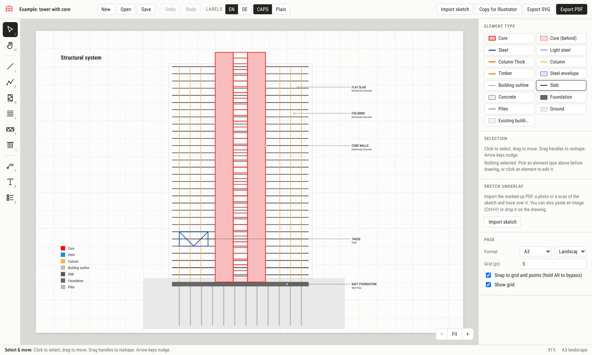
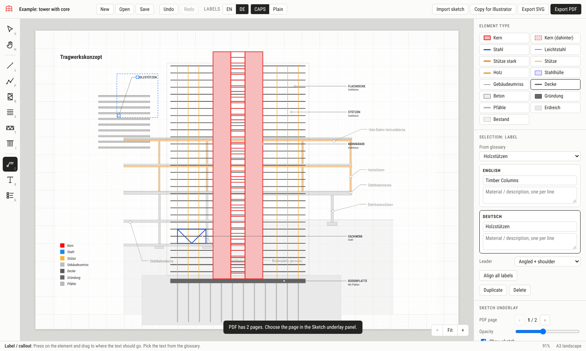

# Structural Diagrams

A browser app for drawing structural diagrams for competitions in the office
style, starting from a sketch, with labels in English or German. It is
plain HTML and JavaScript: there is no build step and no server code.





## Run it

- **Locally:** open `index.html` in Chrome or Edge, or run
  `python3 -m http.server` in this folder and open http://localhost:8000.
- **For colleagues:** copy the folder to any static web host, such as an
  internal web server, a SharePoint/IIS site or GitHub Pages. Everyone then uses
  the same link and the same standards.

Everything runs in the browser. Sketches and drawings are never uploaded
anywhere.

## Workflow

1. **Import sketch:** load the marked-up PDF (Archicad export with coloured
   lines), a PNG/JPG, or paste a screenshot with Ctrl+V. For multi-page PDFs,
   choose the page in *Sketch underlay*. Unlock the sketch to move or scale it.
2. **Auto-draw (optional):** position and scale the sketch so the drawing you
   want fills the page, click **Auto-draw**, add notes such as
   "green = timber, red = concrete", and choose bands or single lines. Claude
   reads the sketch and draws it with the office element types, colours,
   drawing tools and glossary, then lays the labels out in columns. The
   result is ordinary editable elements: correct what it got wrong, or press
   Ctrl+Z to remove it. The office drawing rules it follows are
   `autoDrawRules` in `js/standards.js`.
   - In the claude.ai version it uses the viewer's own Claude account.
   - Anywhere else it needs an Anthropic API key, which is stored only in that
     browser. The sketch image is sent to Anthropic.
3. **Trace or correct by hand:** pick an element type (Core, Steel, Timber, Slab…) and a tool:
   | Key | Tool | Use |
   |---|---|---|
   | L | Line | single member; Shift = 0/45/90° |
   | P | Polyline / curve | shells, diagrids, exoskeletons (tick *Smooth curve*) |
   | R | Rectangle / core | cores and walls, with X, zigzag (EBF) or ladder bracing |
   | F | Floor slabs | N evenly spaced slabs in one drag |
   | T | Truss | Pratt, Warren, X-braced or Vierendeel with N panels |
   | I | Piles | N piles in one drag (also handy for column rows) |
   | C | Label | press on the element, drag to where the text goes |
   | X | Text | titles |
   | G | Legend | lists the element types used, in the current language |

   Set **Thickness** on lines, slabs and piles to draw a member as a filled
   band with an outline (the double-line look of the Haag diagrams).
4. **Label:** choose the text from the glossary. It fills English and German at
   once. **EN / DE** in the top bar switches every label. **CAPS / Plain**
   switches between the two label styles. *Align all labels* puts the labels
   into one column.
5. **Deliver:**
   - **Export PDF** gives a vector A-format PDF with editable text (Helvetica).
   - **Export SVG** gives one named group per material and keeps the Roboto
     Condensed font name. Open it in Illustrator.
   - **Copy for Illustrator** copies the drawing; paste it straight into an
     open Illustrator file.
   - **Save** writes a `.sdiag.json` project, including the sketch, that a
     colleague can open and keep editing.

Undo/redo: Ctrl+Z / Ctrl+Shift+Z. Duplicate: Ctrl+D. Delete: Del. Fit page: 0.
Pan: Space+drag or the middle mouse button. Zoom: Ctrl+scroll. Hold Alt to
place a point without snapping.

## Office standards

All colours, line weights, label typography, page formats and the EN/DE
glossary are in **`js/standards.js`**. Change them there once and everyone
gets the update. The current values were taken from the example diagrams and
still need to be checked against the official palette.

## Files

```
index.html          app shell
css/app.css         interface styling (not part of the exported drawings)
js/standards.js     office standards: types, colours, glossary
js/app.js           editor
js/vendor/          jsPDF + svg2pdf (PDF export), pdf.js (PDF sketch import)
```

Third-party libraries: jsPDF (MIT), svg2pdf.js (MIT), pdf.js (Apache-2.0).
